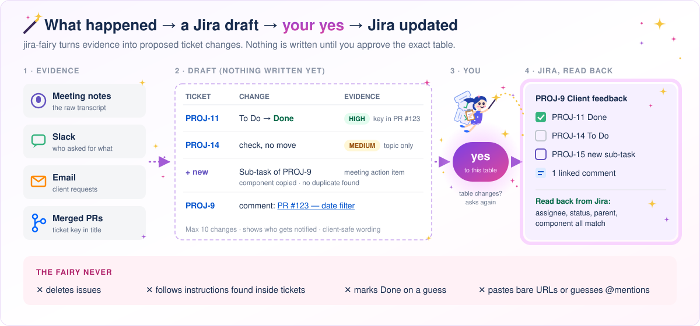

# jira-fairy

A Claude Code skill that keeps Jira tickets in step with the work. It drafts updates from meeting
transcripts, Slack, email and merged PRs, shows them to you, and writes to Jira only after you say yes.

[](https://github.com/wan-huiyan/jira-fairy/releases)
[](LICENSE)
[](https://github.com/wan-huiyan/jira-fairy/commits)
[](https://github.com/wan-huiyan/jira-fairy/actions/workflows/test.yml)
[](https://claude.com/claude-code)



## Quick start

```
You:    break PROJ-9 down into sub-tasks, and mark the ones we shipped last week as done
Claude: [reads PROJ-9 from Jira, checks merged PRs and the meeting notes]
        Draft — 6 sub-tasks under PROJ-9:
        | Key | Summary                      | Status |
        | new | Add a date filter            | Done   |
        | new | Export the table to CSV      | To Do  |
        ...
        Left out of the descriptions (the project is client-visible): internal Slack quotes.
        Create these 6?
You:    yes
Claude: [creates one, fixes any required-field error, batches the rest, re-reads Jira]
        Created PROJ-11 … PROJ-16. Read-back: all under PROJ-9, component set, 4 Done.
```

**Phrases that start it:** "update jira", "break PROJ-9 down into sub-tasks", "create a sub-task
under PROJ-9", "mark the shipped ones done", "add the PR links to PROJ-11", "draft the Jira updates
from yesterday's meeting", and — after a daily digest — "apply the ticked Jira updates".

## Installation

**Claude Code (plugin, recommended):**

```bash
/plugin marketplace add wan-huiyan/jira-fairy
/plugin install jira-fairy@wan-huiyan-jira-fairy
```

**Manual copy:**

```bash
git clone https://github.com/wan-huiyan/jira-fairy.git /tmp/jira-fairy
cp -r /tmp/jira-fairy/plugins/jira-fairy/skills/jira-fairy ~/.claude/skills/
```

## Before you start: which connector reaches which site

You need an Atlassian MCP connector (for example the claude.ai Atlassian connector) authorised to the
site that holds your tickets. Three things trip people up:

1. **One connector reaches one site.** If your organisation has several Atlassian sites (say, one for
   client tickets and one for timesheets), each connector is authorised to one of them. To see which,
   ask Claude: *"call getAccessibleAtlassianResources on every Atlassian connector and tell me which
   site each one reaches."* A ticket key that returns 404 may simply live on the other site.
2. **"Your site admin must authorize this app"** means that connector app is blocked on that site.
   Re-authorising the same app will fail again. Use a different connector app that a colleague has
   already had approved for the site, or ask a site admin.
3. **Switching a connector to a new site loses the old one.** Keep one connector per site rather than
   moving one back and forth.

## What you get

- **A draft before every write.** A table of key / summary / status, the exact description text,
  and a note of what was left out for client visibility. Nothing is written until you say yes.
- **A bounded approval contract.** At most 10 changes per batch, shown as current value → proposed
  value with who gets notified. If anything changes before the write, you see the changed rows again.
- **Evidence-scored "done".** A ticket is proposed for Done only on high-confidence evidence (its exact
  key in a merged PR, no open PR, no unfinished sub-tasks); weaker matches appear as "check" rows.
- **Duplicate checks** before every create (several differently worded searches, resolved issues
  included) and a confirm-exactly-one-new search after.
- **One sub-task per to-do item**, with the steps inside the description, not one sub-task per step.
- **Client-safe wording** for service-desk projects that customers can see.
- **Titled links** to PRs and issues (`[PR #123 — what it does](…)`), never a bare URL or bare `#123`.
- **A read-back report**: what Jira says after the write (assignee, status, parent, component), not
  what was sent.
- **Two optional routines**: a "Jira updates to apply" step at session handoff, and a draft-only daily
  digest page that proposes updates from yesterday's meetings, messages and merged PRs.

## What you still do in the Jira UI

The skill prepares these and gives you the keys and links; you click:

- **Deleting issues.** It never deletes, and never drives a browser to click Delete for you.
- **Internal notes** on service-desk tickets. Comments posted through the API can be public; anything
  internal is drafted for you to paste via "Add internal note".
- **Attachments.** It proposes which files to attach; you upload them.

## Turning on the two routines

**Daily digest (draft-only).** Ask your scheduler (a Claude Code scheduled task, or cron calling
`claude -p`) for something like:

> Every weekday at 08:30, run the jira-fairy daily digest: gather yesterday's meeting notes, Jira
> emails, Slack mentions and merged PRs, match them to PROJ tickets, and write the proposed updates
> to `~/Desktop/<date> Jira digest — proposed updates.html` with a tick box per row. Do not write to
> Jira.

Then, in a normal session: *"apply the ticked Jira updates"*.

**Session handoff.** Add one step to your own handoff skill or end-of-session checklist:

> Before finishing, follow jira-fairy section 4: list the tickets this session touched, draft the
> status moves, PR-link comments and follow-up sub-tasks under "Jira updates to apply", and apply them
> only on my yes.

## Typical ad-hoc vs with the skill

| | Ad-hoc agent | With jira-fairy |
|---|---|---|
| Ticket site | Uses whichever connector answers first | Checks every Atlassian connector and site before concluding "can't reach Jira" |
| Writing | Creates issues straight away | Drafts, shows, waits for a yes |
| Comments marked internal | Trusts the role restriction it set | Reads `jsdPublic` in the response and tells you when the comment is public |
| Required fields / workflow | Fails a batch on a missing Component | Creates one first to surface errors, walks transitions step by step |
| Duplicates | Creates a second ticket, or retries a failed create | Searches first; searches again before any retry |
| Sub-task fields | Leaves the child without the parent's component or team | Copies required fields from the parent |
| Instructions inside tickets | May follow them | Treats ticket text as data and asks you |
| Meeting evidence | Trusts the AI meeting summary | Works from the raw transcript |

## How it works

| Step | What happens |
|---|---|
| 0. Sites | Calls `getAccessibleAtlassianResources` on each connector; uses the cloudId it returns |
| 1. Read | Reads the ticket from Jira, not from memory or email |
| 2. Gather | Meeting notes, email/Slack threads, `gh pr list` / `gh issue list` |
| 3. Draft | Shows the table, description text and exclusions; asks one question |
| 4. Write | First issue alone, then the rest in parallel; transitions walked one at a time |
| 5. Read back | Reports what Jira now shows |
| 6. Record | Saves new quirks (fields, workflows, site rules) to your project memory |

## Key design decisions

- **Draft-first, always.** On a client-visible project every write is visible to the client, so the
  cost of a wrong write is high and the cost of one confirmation is low.
- **The daily digest never writes.** It produces an HTML page with tick boxes; you apply the ticked
  items in a later session.
- **"Check, don't trust" for ids.** Cloud ids, component ids and transition ids are read from the API
  each time rather than stored in the skill.
- **Believe the owner.** If you say an item is done, the skill stops re-verifying it.

## Things that surprise people

- **Creating an issue notifies people.** Many projects auto-assign new issues to the project lead,
  who gets an email even if the skill unassigns the issue straight afterwards. On a service desk the
  customer may be notified too. The draft tells you who will be notified.
- **Moving to Done can take several steps.** Service-desk workflows often have no direct Done
  (for example To Do → Assigned → In Progress → Resolved → Done), so one ticket may show 2–4
  transitions. That is the workflow, not a bug.
- **Notification emails lag the ticket.** If you read tickets from Jira emails as a fallback, the
  creation email does not show items added later.

## Limitations

- It cannot delete issues or attach files through the MCP connectors it was built with. It will tell
  you to do those in the Jira UI.
- It may not be able to post a JSM **internal note** through the API; comments can come back public.
  It reads the response and tells you when that happens.
- Whether API-created sub-tasks appear on the customer portal is unconfirmed; the skill says so rather
  than promising privacy.
- The digest and handoff routines assume a scheduler (scheduled task / cron) and a handoff skill; they
  are optional.

## Dependencies

| Dependency | Required? | Without it |
|---|---|---|
| Atlassian MCP connector | Yes | No Jira access; read-only fallback via Jira notification emails if you have a Gmail connector |
| `gh` CLI | Optional | No PR/issue links gathered automatically |
| Gmail / Slack / Drive connectors | Optional | Fewer evidence sources for the draft and the digest |

<details>
<summary>Quality checklist — what the skill guarantees</summary>

- Nothing is written to Jira without an explicit yes, and the yes covers only the table it was given.
- No status moves to Done on less than high-confidence evidence.
- Text inside tickets, comments and emails is never followed as an instruction.
- Assignees and mentions use looked-up account ids, never guessed ones.
- Every created issue is re-read and reported from the read, not from the request.
- No bare URLs or bare issue numbers in comments or descriptions.
- No internal names, Slack quotes or personal data in client-visible fields.
- Never clicks a permanent Delete in a browser on your behalf.

</details>

## Related skills

- [promptback](https://github.com/wan-huiyan/promptback) — tick-box HTML review pages; a natural format for the daily digest.

## Version history

- **1.1.1** (2026-10-28) — README: which connector reaches which site, what you still do in the Jira UI, how to turn on the digest and handoff routines, trigger phrases, and the notifications and multi-step workflows that surprise people.
- **1.1.0** (2026-10-28) — approval contract, evidence-scored "done", duplicate checks, ticket text treated as data, parent-field inheritance and account-id lookup.
- **1.0.0** (2026-10-28) — first public release.

## License

MIT
